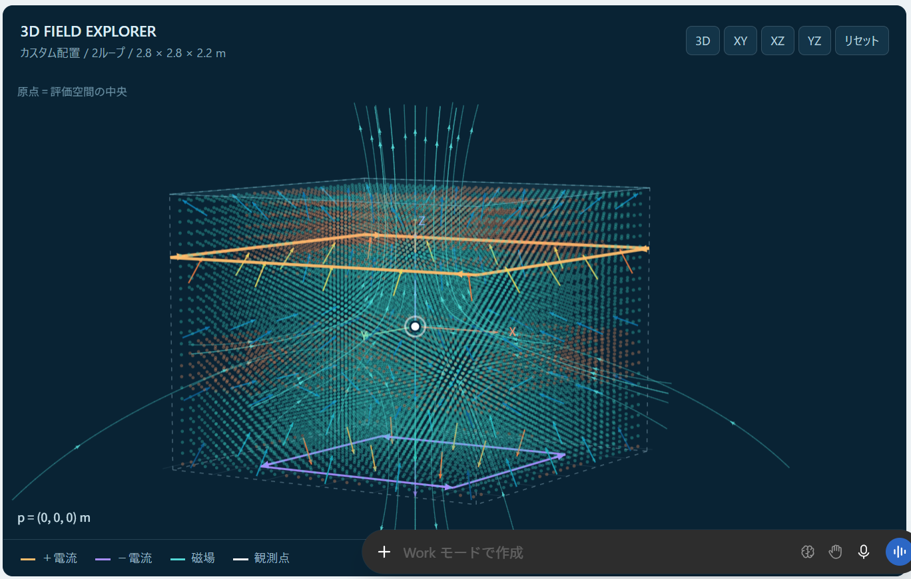
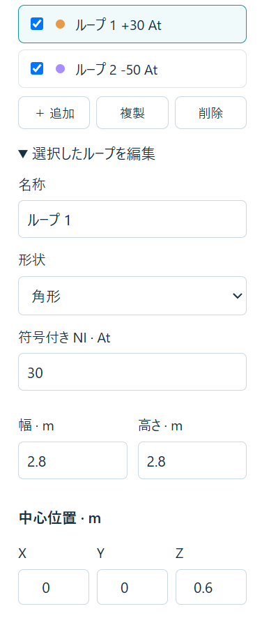
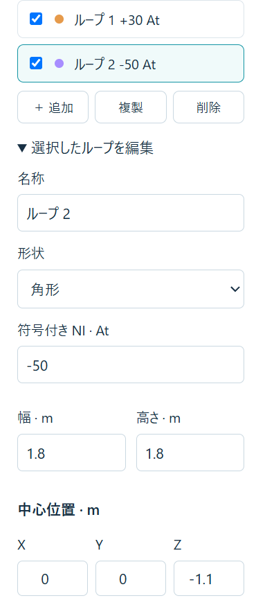
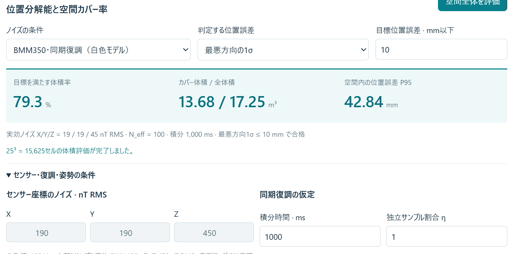

# 参考資料と参照画像

対応する本編は [outline.md](outline.md)、数式と検証計画は [technical-notes.md](technical-notes.md)。外部資料は2026-10-15に内容を確認した。公式文書・メーカーの技術資料・原著論文を優先している。メーカーの性能訴求は、独立した比較実験としては扱わない。

## まず読む5件

| 資料 | この発表で役立つ点 | 対応スライド |
|---|---|---|
| [SlimeVR 101](https://docs.slimevr.dev/slimevr101) | 姿勢、順運動学、HMDを基準にした身体位置推定 | 3・7 |
| [Meta：Powered by AI, Oculus Insight](https://ai.meta.com/blog/powered-by-ai-oculus-insight/) | カメラとIMUを融合する具体例 | 2・6・14 |
| [Woodman：An introduction to inertial navigation](https://www.cl.cam.ac.uk/techreports/UCAM-CL-TR-696.html) | IMUの観測と誤差の蓄積 | 7・14 |
| [Bosch：BMM350データシート](https://www.bosch-sensortec.com/media/boschsensortec/downloads/datasheets/bst-bmm350-ds001.pdf) | 磁気センサーのODR・平均・ノイズ条件 | 9・12・16 |
| [Polhemus：G4 User Manual, Appendix B](https://polhemus.com/_assets/img/G4_User_Manual_URM10PH238-D.pdf) | 磁気トラッキングで生じる金属由来の歪み | 8・15 |

## VRと既存方式

### R01. VRChat, Full-Body Tracking

[公式ドキュメント](https://docs.vrchat.com/docs/full-body-tracking)

追加の身体観測点、アバターとのキャリブレーション、IKを説明する資料。画面例はVR初心者への導入にも向く。ただしこのページの対応方式に関する記述だけで製品互換性を断定しない。OSC入力についてはR03の専用ページが別途存在する。

### R02. SlimeVR, SlimeVR 101

[公式ドキュメント](https://docs.slimevr.dev/slimevr101)

各IMUが部位の回転を測り、順運動学で身体を構成し、HMDの位置を参照する仕組み。ページ内の骨格アニメーションも説明の参考になる。IMUの二重積分で全身位置を直接測っていると誤解しないために重要。

### R03. VRChat, OSC Trackers

[公式ドキュメント](https://docs.vrchat.com/docs/osc-trackers)

外部プログラムからトラッカーの位置・回転を入力するためのアドレスと座標仕様。自作推定器からVRChatへ出力する候補として参照する。OSCは通信形式、VMCは別のメッセージ仕様であり、同じOSCを使うからそのまま互換とは限らない。

### R04. Ben Jackson / Valve, SteamVR Hardware（2016）

[発表スライドPDF](https://cdn.akamai.steamstatic.com/apps/steamdevdays/slides2016/SteamVRTracking.pdf)

Lighthouseのベースステーション、受光素子、電子回路、ホストの役割を紹介する一次資料。図を探すときは前半のSystem Overview / Basestation / Sensorsを参照する。2016年資料であり、後の2.0方式の同期・符号化まで説明したものとして使わない。

### R05. Meta, Powered by AI: Oculus Insight（2019-08-22）

[技術解説](https://ai.meta.com/blog/powered-by-ai-oculus-insight/)

部屋の特徴を用いるvisual-inertial SLAM、コントローラーの光学的な観測、IMUによる速い更新を説明している。初代Quest / Rift Sの仕組みについての資料で、Quest 3のすべての内部実装を示す資料ではない。汎用的な融合の考え方に用いる。

### R06. Meta, Using deep neural networks for accurate hand-tracking on Oculus Quest（2019-09-25）

[技術解説](https://ai.meta.com/blog/hand-tracking-deep-neural-networks/)

カメラ画像から素手の関節を推定する処理の説明。コントローラーを追う処理と、素手の形を推定する処理を分けるために参照する。

### R07. OptiTrack, Markers

[公式ドキュメント v3.0](https://docs.optitrack.com/v3.0/motive/markers)

反射マーカーをカメラで観測し、画像上の検出から3次元を再構成する例。アウトサイドイン方式を、単眼Webカメラの機械学習による骨格推定だけで代表させないための資料。

### R08. HTC, VIVE Ultimate Tracker

[メーカー製品・FAQページ](https://shop-us.vive.com/pages/vive-ultimate-tracker)

トラッカー自身のカメラによるインサイドアウト方式の製品例。本編では構成の例だけに使い、地域・時点で変わる価格を固定的な比較へ使わない。

### R09. KirisameNanoha, VIVEトラッカーを作ってみよう

[作者の製作記](https://note.com/kirisamenanoha/n/nd3ba7207bc5b)

元アウトラインにあった自作事例。受光回路、マイコン、IMUを組み合わせる製作報告として残す。作者自身も姿勢ドリフトなどの限界を記述しているため、完成した市販機と同等の精度を示す根拠には使わない。

## IMU・磁場・推定の基礎

### R10. Oliver J. Woodman, An introduction to inertial navigation（2007）

University of Cambridge, Technical Report UCAM-CL-TR-696。

[書誌情報・要約](https://www.cl.cam.ac.uk/techreports/UCAM-CL-TR-696.html) ／ [本文PDF](https://www.cl.cam.ac.uk/techreports/UCAM-CL-TR-696.pdf)

慣性航法と誤差の伝播を理解する原著の技術報告。発表では物理モデルと誤差が積分される構造を参照し、掲載装置の古い性能値を現在のIMU一般へ外挿しない。

### R11. OpenStax, University Physics Volume 2, §12.1 The Biot–Savart Law

[本文](https://openstax.org/books/university-physics-volume-2/pages/12-1-the-biot-savart-law)

電流と導線形状から磁場を求める基礎。大型コイルの順問題の出典。自作案の性能や観測可能性の検証資料ではない。

### R12. FluxPose, Technology / How it works

[Technology](https://www.fluxpose.com/technology) ／ [製品ページと原理解説](https://www.fluxpose.com/)

ビーコンを基準にした磁場方式と、加速度計・ジャイロとの融合を説明する公式資料。サイトの性能・重量・電池持ちの値はメーカー公称値。公開資料だけから、三軸送受信コイルの具体的構成や周波数の割り当てを断定しない。

2026-10-15確認時点では購入・キャンペーンへの導線があるため、「まだ発売されていない」と固定的に記述するのは避けた。出荷状況や納期の検証は本発表の範囲に含めていない。

### R13. Polhemus, G4 User Manual, Appendix B: Understanding Distortion

[公式PDF](https://polhemus.com/_assets/img/G4_User_Manual_URM10PH238-D.pdf) ／ [磁気トラッキング概要](https://polhemus.com/motion-tracking)

既知の磁場から位置・姿勢を推定する方式と、透磁率・渦電流による歪みを理解する資料。G4のAC方式と今回の準静的な切替方式では、過渡や周波数依存性が異なる。資料中の精度値を自作案へ転用しない。

### R14. GTSAM, FixedLagSmoother

[公式ドキュメント](https://borglab.github.io/gtsam/fixedlagsmoother/)

時刻付き状態を一定期間保持して更新する実装の参考。発表では、過去の観測を過去の状態へ適用し、現在まで再伝播する考え方を説明する。使用ライブラリや推定アルゴリズムを決定したという意味ではない。

### R15. Alexander Ly et al., A Tutorial on Fisher Information（2017）

[論文概要・本文へのリンク](https://arxiv.org/abs/1705.01064)

Fisher情報と推定分散の理論的な限界を理解する論文。シミュレーションのCRLBを、実測の誤差や成功率と混同しないための背景資料。

## 自作候補部品

### R16. Bosch Sensortec, BMM350

[製品仕様](https://www.bosch-sensortec.com/en/products/motion-sensors/magnetometers/bmm350) ／ [データシートPDF](https://www.bosch-sensortec.com/media/boschsensortec/downloads/datasheets/bst-bmm350-ds001.pdf)

3軸磁気センサー。読む箇所はノイズ条件、ODRと内部平均設定の組合せ、タイムスタンプやデータ取得条件、温度と較正に関する仕様。公開仕様にあるノイズ値だけでは、1秒平均後の実環境ノイズや位置精度は決まらない。

### R17. STMicroelectronics, LSM6DSV16X

[データシートPDF](https://www.st.com/resource/en/datasheet/lsm6dsv16x.pdf)

3軸加速度計と3軸ジャイロを含むIMU。センサーの出力と、内蔵の姿勢推定機能が生成する量を区別して読む。搭載する機能だけで、部屋を基準とした絶対位置が得られるわけではない。

## 参照会話の添付画像

### P01. トラッカー自作

[参照会話](chatgpt-conversation://6a9c2016-ac18-83e8-93d7-71f54d21191f)

今回確認できた直近の議論では、大型空芯コイルの +I / 0 / −I 切替を使い、磁場マップによってIMUの長期ドリフトを抑える案を検討している。旧案の低周波FDMA、FFT、Neural SLAMを中心に据えた説明は採用していない。

会話内の提案や試算は計画資料として扱い、検証済みの工学的事実とは区別した。会話で言及された注文情報を発表の根拠として再調査する必要はないため、今回はメールにはアクセスしていない。

以下の4画像は参照会話の添付を、そのまま本フォルダへ保存した。新たなシミュレーションを実行した結果ではない。

### P02. 磁場配置の表示

用途：スライド10または16で部屋スケールの配置を説明する。画面に表示されたベクトル場が、独立観測を束ねたものか合成場かは画像だけでは確定しない。TDMAの観測モデルを説明する図として無条件に読み替えない。

### P03. 上部コイルの設定

画像から読める条件：2.8 m × 2.8 mの角形、中心 (0, 0, 0.6) m、符号付きNI = +30 At。画像の座標原点は評価空間の中央。

### P04. 床側コイルの設定

画像から読める条件：1.8 m × 1.8 mの角形、中心 (0, 0, −1.1) m、符号付きNI = −50 At。マイナスは電流・巻線方向の符号を表す。

### P05. 位置分解能と空間カバー率の表示

画像から読める数値は次のとおり。

| 項目 | 画像の表示 |
|---|---|
| 評価基準 | 最悪方向の1σ ≤ 10 mm |
| 条件を満たす体積率 | 79.3% |
| 条件を満たす体積／全体積 | 13.68 / 17.25 m³ |
| 空間内の位置誤差P95という表示 | 42.84 mm |
| 実効ノイズX/Y/Z | 19 / 19 / 45 nT RMS |
| 独立サンプル数 | N_eff = 100 |
| 積分時間 | 1,000 ms |
| モデル | BMM350・同期復調（白色モデル） |
| 評価セル数 | 25³ = 15,625 |

**本編でのキャプション案**：

> 参照会話のシミュレーション画面。白色・独立ノイズ等の仮定の下で、表示上は評価空間の79.3%が「最悪方向1σ ≤ 10 mm」。実機での達成率ではない。姿勢不確かさと時分割中の運動を含む評価が今後必要。

体積率を「測定成功率」と読み替えない。P95を「実機の95%の誤差が42.84 mm以内」と説明しない。コード未確認のため、表示が厳密にどの共分散・観測モードから計算されているかは未検証。

## スライドへ引用するときの書き方

- 各スライドのノートに資料名・URL・閲覧日を記載する。
- 数値には単位、仮定、メーカー公称／自分の計算／実測の別を添える。
- 図を転載する場合は権利表示・利用条件を確認し、出典を明記する。外部資料全体を転載する代わりに、元ページまたは公式PDFへリンクする。
- この参考資料の正負差分・最小二乗などの数式は、設計モデルの説明として作成した。市販製品の実装そのものを再現した式とは記載しない。

## 追加した製品画像・公式解説図

本編の方式説明の間に、独立した画像スライド6枚を追加した。掲載元・原画像URL・閲覧日・抜粋等の処理は [image-credits.md](image-credits.md)、機械可読な記録は [image-sources.json](image-sources.json) を参照。

| 画像ID | 内容 | 掲載元 |
|---|---|---|
| I01・I02 | 身体への装着例とアバターへの反映イメージ | HTC VIVE |
| I03・I04 | VIVE Tracker (3.0) と SteamVR Base Station 2.0 | HTC VIVE |
| I05 | 受光時刻から掃引角を求める公式解説図（Lighthouse 1.0） | Ben Jackson / Valve、SteamVR Hardware (2016)、PDF p.8 |
| I06 | VIVE Ultimate Tracker のカメラ | HTC VIVE |
| I07・I08 | SlimeVR の本体・ストラップと基板・電池 | SlimeVR、掲載：Crowd Supply |
| I09・I10 | FluxPose のビーコンとトラッカー | FluxPose |
